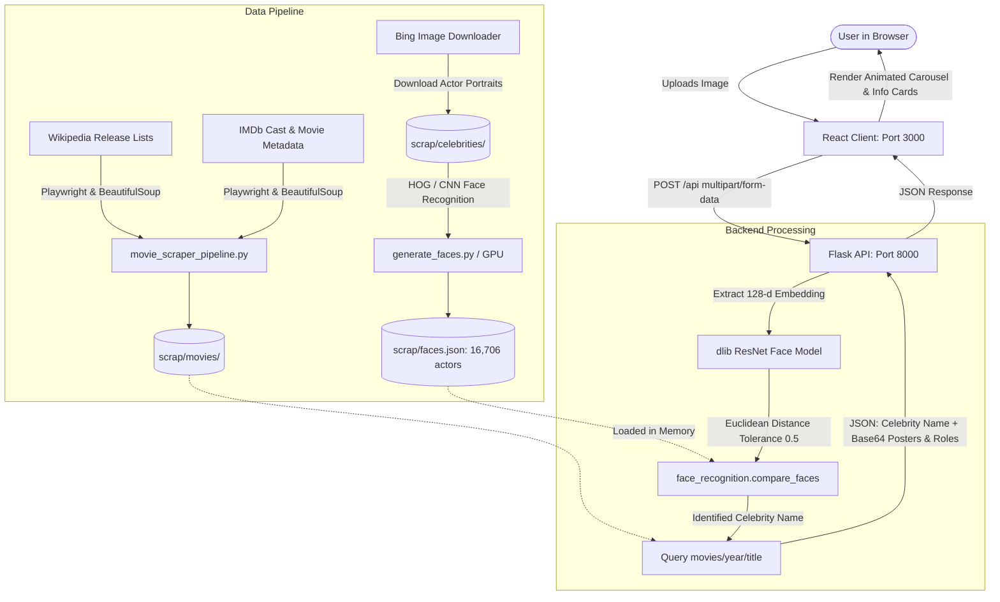

# 🎬 Celebrity Face Recognition & Filmography Explorer (PFA)

An end-to-end intelligent computer vision and web application system that identifies celebrities from portrait photographs and immediately retrieves their complete filmography, characters played, movie posters, and storyline synopses.

---

## 📑 Table of Contents
1. [Overview](#-overview)
2. [Visual Tour & Screenshots](#-visual-tour--screenshots)
3. [System Architecture](#-system-architecture)
4. [Project Structure](#-project-structure)
5. [Deep Dive into Components](#-deep-dive-into-components)
   - [Frontend (React SPA)](#1-frontend-react-single-page-application)
   - [Backend (Flask REST API)](#2-backend-flask-rest-api)
   - [Scraping & Data Acquisition Pipeline](#3-scraping--data-acquisition-pipeline)
   - [Face Encoding Engine (CPU & GPU)](#4-face-encoding-engine-cpu--gpu)
   - [Analytics & Maintenance Tools](#5-analytics--maintenance-tools)
6. [Data Schema & Storage Format](#-data-schema--storage-format)
7. [Installation & Setup](#-installation--setup)
8. [Running the Application](#-running-the-application)
9. [API Specification](#-api-specification)
10. [Troubleshooting & FAQ](#-troubleshooting--faq)

---

## 🌟 Overview

The **Celebrity Face Recognition & Filmography Explorer** is designed to solve the *“Who is that actor and what movies have they starred in?”* question seamlessly. The project combines state-of-the-art facial landmark detection and 128-dimensional metric face embeddings with automated web scraping and a rich, responsive React client.

### Key Highlights
- **16,700+ Celebrities Indexed**: Pre-computed face encodings covering 38,800+ photo embeddings in a serialized vector database (`faces.json`).
- **Comprehensive Movie Database**: Hundreds of feature films cataloged across release years (2021, 2022, 2023), complete with high-resolution posters, cast lists, character mappings, and plot summaries.
- **Accurate Face Biometrics**: Powered by `dlib` and `face_recognition`, using ResNet-based deep metric learning where the Euclidean distance between faces directly reflects visual identity.
- **Interactive Carousel Interface**: Dynamic card slider presenting movie appearances, character roles, release years, and synopses with smooth animations and dynamic styling.
- **Resilient Web Harvester**: Headless/headful Playwright scraper capable of handling IMDb rate limits, human verification challenges, and Wikipedia release directories.

---

## 📸 Visual Tour & Screenshots

### 1. Web Application: Matched Celebrity Filmography (Card 1)
When an image is uploaded and recognized (e.g., actor *Seth Fuentes*), the application displays the actor's name along with an interactive carousel of movies they appeared in. Below, *Seth Fuentes* is matched and his appearance in the 2023 movie **Air** as "Restaurant Guest" is shown:


---

### 2. Web Application: Carousel Navigation (Card 2)
Navigating through the carousel reveals additional filmography entries. Here, *Seth Fuentes* is displayed in the 2023 DC film **Blue Beetle** playing the role of "Student":


---

### 3. Web Application: Multi-Movie Filmography (Card 3)
Browsing further displays the 2023 comedy film **Bottoms**, where the actor also portrays a "Student", complete with synopsis and poster:


---

### 4. Celebrity Reference Dataset
The automated image scraper collects high-quality portrait datasets for every actor. The directory contains over **8,045+ individual celebrity folders**:


---

### 5. Movie Catalog & Metadata Store
The scraped movie catalog (organized by release year, such as `movies/2023`) contains hundreds of folders (e.g., 338 films in 2023 alone), each storing posters, cast mappings, descriptions, and metadata:


---

## 🏗 System Architecture



---

## 📁 Project Structure

```plaintext
PFA/
├── backend/
│   └── server.py                   # Flask REST API server (port 8000)
├── frontend/
│   ├── public/                     # Static HTML template & favicons
│   │   ├── favicon.ico
│   │   ├── index.html
│   │   └── manifest.json
│   ├── src/
│   │   ├── App.css                 # Custom styling for cards, carousel, spinner
│   │   ├── App.js                  # Main React component (Uploader, Carousel, Cards)
│   │   ├── App.test.js             # Unit testing suite
│   │   ├── hollywoodBg.jpg         # Hero background graphic
│   │   ├── index.css               # Global baseline stylesheet
│   │   ├── index.js                # React DOM entry point
│   │   └── reportWebVitals.js      # Core web vitals reporting
│   ├── package.json                # Frontend dependencies & scripts
│   ├── package-lock.json
│   └── peter.jpg                   # Sample test portrait
├── movies/                         # Directory junction to scrap/movies
│   ├── 2021/                       # 177 movie folders
│   ├── 2022/                       # 307 movie folders
│   └── 2023/                       # 338 movie folders
├── scrap/
│   ├── celebrities/                # 8,000+ folders of downloaded celebrity photos
│   ├── movies/                     # Scraped movie archive by year
│   │   └── <year>/
│   │       └── <Movie_Title>/
│   │           ├── .complete       # Status flag indicating full ingestion
│   │           ├── casts.json      # Mapping: Actor Name -> Character Name
│   │           ├── cast_details.json# Detailed cast array with billing order
│   │           ├── description.txt # Full movie synopsis / storyline
│   │           ├── metadata.json   # IMDb ID, URL, runtime, genres
│   │           └── photo.jpg       # Movie poster image
│   ├── movie_scraper_pipeline.py   # Wikipedia + IMDb + Bing scraping pipeline
│   ├── generate_faces.py           # CPU multi-threaded face encoding builder
│   ├── generate_faces_gpu.py       # GPU batch-accelerated face encoding builder
│   ├── most.py                     # Analytics script: rank actors with most movies
│   ├── delete.py                   # Dataset cleaner: prune empty celebrity folders
│   ├── faces.json                  # Vector database (16,706 celebrities, 38,860 encodings)
│   ├── faces_gpu_cache.json        # Resumable cache for GPU face detection
│   └── dlib_build.log              # Compilation log for dlib installation
├── screenshots/                    # Application & dataset UI screenshots
│   ├── Screenshot 2026-10-24 024008.png
│   ├── Screenshot 2026-10-24 024019.png
│   ├── Screenshot 2026-10-24 054936.png
│   ├── Screenshot 2026-10-24 054949.png
│   └── Screenshot 2026-10-24 054955.png
└── README.md                       # Comprehensive project documentation
```

---

## 🔍 Deep Dive into Components

### 1. Frontend (React Single-Page Application)
Located in [`frontend/`](file:///F:/PFA/frontend), the UI is built using React 18:
- **`App.js`**: Contains three primary states:
  - **Upload State (`Input`)**: Clean hero screen with `hollywoodBg.jpg`, supporting both drag-and-drop file upload and standard file selector.
  - **Loading State (`Spinner`)**: Rotating animated spinner displaying feedback while facial encodings are calculated and compared against 16,700+ entries.
  - **Result State (`CardPage`)**:
    - Displays the user's uploaded portrait next to the recognized celebrity name.
    - An animated horizontal carousel (`List` & `Card`) powered by CSS transforms (`translateX(-${currentCardIndex * 700}px)`).
    - Each card displays the movie poster (decoded from base64), movie title, release year, actor's character name, and movie description.
    - Navigation buttons (`-` and `+`) with counter display (e.g. `1/3`).
  - **Error State (`ErrorPage`)**: Displays clear user guidance if multiple faces or no faces are detected, with a one-click reload button.
- **`App.css`**: Provides styling with flexbox layouts, card shadows, transparent gradients, and responsive sizing.

---

### 2. Backend (Flask REST API)
Located in [`backend/server.py`](file:///F:/PFA/backend/server.py):
- **CORS Support**: Configured via `flask_cors.CORS(app)` to accept cross-origin requests from the React development server on port 3000.
- **Face Detection and Validation**:
  - Loads the uploaded image using `face_recognition.load_image_file()`.
  - Enforces strict single-face validation:
    ```python
    faces = face_recognition.face_encodings(img)
    if len(faces) != 1:
        return jsonify({"message": "image must have exactly one face"})
    ```
- **Embedding Comparison**:
  - Compares the 128-dimensional embedding against all encodings in `faces.json` with a tolerance threshold of `0.5`:
    ```python
    result = face_recognition.compare_faces(faces, face, tolerance=0.5)
    if True in result:
        cname = name
        break
    ```
- **Filmography Query**:
  - Scans `../movies/{year}` across catalogs (2021–2023).
  - Checks if `cname in data.keys()` inside `casts.json`.
  - Reads movie poster `photo.jpg` and base64 encodes it into an ASCII string.
  - Reads `description.txt`.
  - Packages and returns `[celebrity_name, movies_list]`.

---

### 3. Scraping & Data Acquisition Pipeline
Located in [`scrap/movie_scraper_pipeline.py`](file:///F:/PFA/scrap/movie_scraper_pipeline.py):
- **Wikipedia Movie Harvesting**:
  - Scrapes `https://en.wikipedia.org/wiki/List_of_American_films_of_{year}`.
  - Parses standard Wikipedia HTML tables to extract verified film titles.
  - Caches HTML pages locally (`american_films_{year}.html`) to prevent repeat requests.
- **IMDb Playwright Browser Automation**:
  - Launches a persistent Chromium browser profile (`user_data_dir`) with customized viewport and User-Agent headers.
  - Supports importing existing cookie sessions (`cookie_file`).
  - **Bot Detection Handling**: Intelligently senses Amazon WAF security challenges (`let's confirm you are human`, `robot check`, status `202/403/429`), pauses execution, alerts the developer in the console to solve the CAPTCHA interactively in the browser, and resumes automatically.
  - Scrapes:
    - Full cast & crew with character names (`/fullcredits`).
    - Movie poster image (`photo.jpg`).
    - Official storyline/synopsis (`description.txt`).
    - JSON metadata (`metadata.json`).
- **Bing Celebrity Image Downloader**:
  - Automatically queries Bing Image Search for each cast member to download 3–5 representative portrait photographs.
  - Saves images into dedicated folders under `scrap/celebrities/{Actor_Name}/`.

---

### 4. Face Encoding Engine (CPU & GPU)

#### A. CPU Multi-Threaded Generator (`scrap/generate_faces.py`)
- Traverses `celebrities/` and detects faces using HOG (Histogram of Oriented Gradients) or CNN models.
- Rejects images that contain 0 or multiple faces to guarantee high data quality.
- Employs an incremental cache (`faces_cache.json`) checking file size and modification timestamps (`mtime_ns`) so previously computed faces are never recomputed.
- Writes atomically to `faces.json.tmp` and replaces `faces.json` safely to avoid data corruption.

#### B. GPU Batch-Accelerated Generator (`scrap/generate_faces_gpu.py`)
- Utilizes `dlib` compiled with CUDA support for high-throughput batch detection.
- Normalizes orientations via EXIF metadata using `PIL.ImageOps.exif_transpose()`.
- Standardizes images into fixed-dimension square tensors with padding to preserve aspect ratio.
- Employs cuDNN accelerated CNN face detection for processing large volumes of celebrity images.

---

### 5. Analytics & Maintenance Tools

#### A. Filmography Ranking (`scrap/most.py`)
- Analyzes all movie folders in `movies/` across all years.
- Aggregates cast appearances and computes ranking metrics:
  ```plaintext
  ============================================================
  TOP 3 CELEBRITIES WITH MOST MOVIE APPEARANCES
  ============================================================
  #1 ...
  Total movies: 8
  Movies:
     - Movie A (2023)
     - Movie B (2022)
  ...
  ============================================================
  Movies analyzed: 822
  Unique celebrities: 16,706
  ============================================================
  ```

#### B. Dataset Cleanup (`scrap/delete.py`)
- Audits `scrap/celebrities/`.
- Deletes any folder that failed download or contains 0 valid image files, keeping the dataset clean and optimizing memory usage.

---

## 💾 Data Schema & Storage Format

### 1. `faces.json` (Vector Database)
A JSON mapping of celebrity names to arrays of 128-float embedding vectors:
```json
{
  "Seth Fuentes": [
    [-0.1423, 0.0891, 0.0451, ..., -0.0129]
  ],
  "Margot Robbie": [
    [-0.0982, 0.1214, 0.0341, ..., 0.0512],
    [-0.0911, 0.1189, 0.0355, ..., 0.0488]
  ]
}
```

### 2. Movie Record (`scrap/movies/<year>/<title>/`)
- **`casts.json`**:
  ```json
  {
    "Matt Damon": "Sonny Vaccaro",
    "Ben Affleck": "Phil Knight",
    "Jason Bateman": "Rob Strasser",
    "Seth Fuentes": "Restaurant Guest"
  }
  ```
- **`metadata.json`**:
  ```json
  {
    "title": "Air",
    "year": 2023,
    "imdb_id": "tt16419074",
    "url": "https://www.imdb.com/title/tt16419074/"
  }
  ```
- **`description.txt`**: Plain text containing the plot overview.
- **`photo.jpg`**: High-resolution movie poster.

---

## 🚀 Installation & Setup

### Prerequisites
1. **Python**: Python 3.11 or 3.14 (64-bit) with C++ build tools (CMake, Visual Studio C++ build tools for `dlib`).
2. **Node.js**: v18.x or higher (v24 LTS recommended) and `npm`.
3. **Operating System**: Windows 10/11, macOS, or Linux.

### 1. Clone & Prepare Directory Junction
If running on Windows, create a directory junction in the project root pointing to the movies repository:
```powershell
# In PowerShell at project root (F:\PFA)
cmd /c mklink /J "movies" "scrap\movies"
```

### 2. Install Python Dependencies
```bash
# Python dependencies
pip install flask flask-cors face-recognition dlib numpy pillow requests beautifulsoup4 playwright bing-image-downloader
```
*(If using Playwright for scraping, install the Chromium browser driver: `playwright install chromium`)*

### 3. Install Frontend Dependencies
```bash
cd frontend
npm install
```

---

## ⚡ Running the Application

### 1. Start the Flask Backend Server
In a terminal, navigate to the `backend` folder and run:
```bash
cd F:\PFA\backend
python server.py
```
- The backend will start on **`http://127.0.0.1:8000`**.
- It exposes the POST endpoint at `http://127.0.0.1:8000/api`.

### 2. Start the React Frontend Application
In a separate terminal, navigate to the `frontend` folder and run:
```bash
cd F:\PFA\frontend
npm start
```
- The frontend development server will launch on **`http://localhost:3000`**.
- The browser will open automatically displaying the upload interface.

---

## 📡 API Specification

### Endpoint: `POST /api`
Accepts a single portrait photo and returns the identified celebrity and filmography.

#### Request
- **Method**: `POST`
- **Content-Type**: `multipart/form-data`
- **Body**:
  - `face`: File (Image: `.jpg`, `.jpeg`, `.png`, etc.)

#### Successful Response (`200 OK`)
```json
[
  "Seth Fuentes",
  [
    {
      "Air": [
        "<base64_encoded_photo_string>",
        "Restaurant Guest",
        2023,
        "The history of the game-changing partnership between Michael Jordan and Nike..."
      ]
    },
    {
      "Blue Beetle": [
        "<base64_encoded_photo_string>",
        "Student",
        2023,
        "An alien scarab chooses Jaime Reyes to be its symbiotic host..."
      ]
    }
  ]
]
```

#### Error Responses
- **Multiple or No Faces Detected**:
  ```json
  {
    "message": "image must have exactly one face"
  }
  ```
- **No Celebrity Match Found**:
  ```json
  {
    "message": "your photo does not match with any celebrity"
  }
  ```

---

## 🛠 Troubleshooting & FAQ

#### 1. Why does the API return `"image must have exactly one face"`?
The system requires an unobstructed photo containing exactly one individual. Ensure the uploaded photo is well-lit, faces forward, and does not have multiple people in the frame.

#### 2. How can I adjust face recognition sensitivity?
In `backend/server.py`, locate the tolerance parameter:
```python
result = face_recognition.compare_faces(faces, face, tolerance=0.5)
```
- Lower tolerance (e.g. `0.4`): Stricter match, reduces false positives.
- Higher tolerance (e.g. `0.6`): Looser match, allows more variations in lighting, angle, and age.

#### 3. How do I add new movies or celebrities?
1. Add the year to `movie_scraper_pipeline.py` and run it to scrape new movie titles, casts, and photos.
2. Re-run `python scrap/generate_faces.py` (or `generate_faces_gpu.py`). The incremental cache will process only newly added celebrity photos and update `faces.json` automatically.

---

## 📄 License & Credits
Developed as an academic capstone project (**PFA - Projet de Fin d'Année**). 
Powered by `dlib`, `face_recognition`, `React`, `Flask`, `Playwright`, and `BeautifulSoup`. All movie poster assets and metadata belong to their respective copyright holders on IMDb and Wikipedia.
